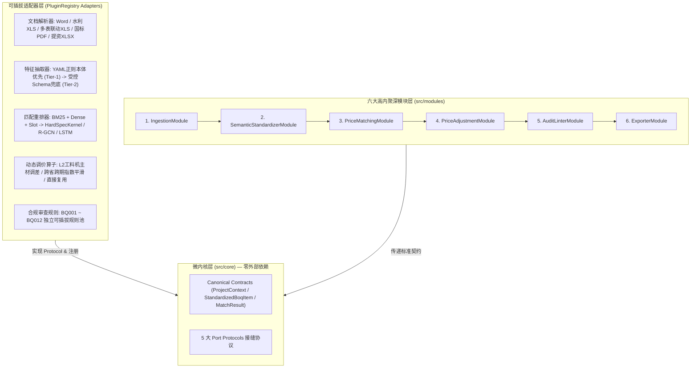

# BOQ Intelligence — 工程量清单语义标准及智能价格匹配平台

> 面向水利生态治理、全域土地综合整治、城乡给排水、灌区工程、煤矿疏干水、海洋生态修复与通用安装工程的**工程造价数据资产化、语义标准化、混合智能匹配、L2 工料机动态调差与合规审查一体化工作台**。

---

## 核心特性

1. **微内核深模块可插拔架构（Microkernel + Deep Modules + Plugin Registry）**
   * 模块间仅通过 `src/core/contracts/` 中不可变的 Pydantic 标准数据契约通信，通过 5 大 Python `Protocol` 接缝（`DocumentParserPort`、`FeatureExtractorPort`、`RetrieverPort / RerankerPort / ExplainerPort`、`PriceAdjusterPort`、`AuditRulePort`）实现单文件热插拔扩展。
2. **三层四维工程量清单语义标准与声明式 YAML 本体**
   * 将自然语言清单自动拆解为**标识层**（领域码+分部层级路径+标准主名称）、**特征层**（实体材质规格 / 施工工艺 / 环境工况）与**数值量纲层**（`hm² ↔ 亩 ↔ m²`、`万元 ↔ 元` 自动归一化）。
   * 7 大工程专业领域的特征槽位、正则模板与层次分析法（AHP）权重全部外置配置于 `configs/domains/*.yaml`，新增专业无需修改核心代码。
3. **三段式混合匹配 + 硬规格指数衰减核（解决数值规格错配痛点）**
   * **多路混合召回 + RRF 融合**：工程专有分词 BM25 + 字符 N-gram 语义向量投影 + 结构化槽位匹配。
   * **硬规格指数衰减核（Hard-Spec Decay Kernel）**：对电缆等效总截面积（如 `3×150+1×95 = 545 mm²` vs `3×25+1×16 = 91 mm²`）、土方运距（`5km` vs `0.5km`）、苗木地径等硬约束数值差异施加指数惩罚 $\Phi_k = \exp(-\alpha \frac{|x_q - x_c|}{\max(x_q, x_c)})$，杜绝字面余弦相似度虚高导致的量级错配。
   * **内置科研对比基线**：同一引擎支持一键热切换 `production_hybrid`、`rgcn_graph_reranker`、`hybrid_no_decay` 与 `lstm_cosine_baseline` 进行消融对比实验。
4. **L0 / L1 / L2 三级价格存储与工料机动态调差**
   * 同时支持仅含综合单价的概估算导表（L1）和含完整定额工料机消耗量分析表（L2）。跨省跨期复用时，可自动将历史定额消耗中的柴油、水泥等主材替换为新项目最新信息价并联动税金重算单价。
5. **`BQ001~BQ012` 合规审查 + 一键导出原生公式估算表 + 三级校审回流**
   * 自动检测缺失单位、硬特征漏填、算术不闭合、同表同特征单价冲突与历史偏离预警；一键导出带 `=ROUND(...)` 与 `=SUM(...)` 原生公式的标准化 `.xlsx` 估算表；支持人工校审修改原因回流数据库驱动增量学习。
6. **Apple Liquid Glass 流体毛玻璃极简工作台**
   * 零外部 CDN 依赖（支持纯内网离线部署），具备三层光学折射毛玻璃质感、**极光（Aurora）/ 稿纸（Paper）/ 示波（Spectrum）** 三态主题切换、Spotlight 极简搜价舞台、渐进式右侧检视抽屉与弹簧物理微交互。

---

## 系统架构图



---

## 目录结构

```text
.
├── configs/
│   ├── domains/                 # 7大工程领域 YAML 特征本体与 AHP 权重矩阵
│   └── pipelines.yaml           # 匹配流水线与 BQ 审查规则开关配置
├── docs/                        # 全套架构契约、PRD、语义标准、数据治理、算法白皮书与 ADR
│   ├── 00-PRD.md
│   ├── 01-ARCHITECTURE-AND-CONTRACTS.md
│   ├── 02-BOQ-SEMANTIC-STANDARD-AND-ONTOLOGY.md
│   ├── 03-DATA-GOVERNANCE-AND-DUAL-DB-SPEC.md
│   ├── 04-HYBRID-MATCHING-AND-PRICING-WHITEPAPER.md
│   ├── 05-PLUGIN-EXTENSION-PLAYBOOK.md
│   └── adr/
├── src/
│   ├── core/                    # 微内核：Contracts + Ports + PluginRegistry
│   ├── modules/                 # 六大深模块：ingestion / standardizer / matching / pricing / auditing / exporter
│   ├── infrastructure/          # SQLite 双库持久化仓储（价格库 + 规则知识图谱 + 回流日志）
│   └── api/                     # FastAPI 接口与 Liquid Glass 离线前端工作台
├── tests/                       # 面向深模块门面接口的契约测试套件
├── GLOSSARY.md                  # 工程造价与智能匹配领域统一词汇表
├── requirements.txt
└── run.py
```

---

## 快速开始

### 1. 安装依赖

```bash
pip install -r requirements.txt
```

### 2. 启动 Web 工作台

```bash
python3 run.py
```

启动后访问 `http://127.0.0.1:8000` 即可使用 **智能搜价、批量组价出估算表、资产图谱、科研消融评测** 全套功能。

> **关于本地私有数据目录 `data/`**：
> 为保护企业历史造价数据隐私，`.gitignore` 已屏蔽 `data/` 目录及所有 `.xls/.xlsx/.doc/.docx/.pdf/.db` 原始工程文件。
> - 当外部克隆本仓库首次启动时，系统会自动注入脱敏演示数据集以供开箱体验；
> - 在内部生产环境使用时，只需将您的成套造价文件（Word 编制说明 + Excel/PDF 计价表）放入本地 `data/` 目录或在 Web 界面的「资产图谱 → 解析入库项目包」上传，系统即自动解析建库并构建规则知识图谱。

### 3. 运行契约测试

```bash
pytest -v tests/test_deep_modules.py
```

---

## 文档导航

* [统一领域词汇表 (GLOSSARY.md)](GLOSSARY.md)
* [产品需求说明书 (00-PRD.md)](docs/00-PRD.md)
* [微内核深模块架构、数据契约与接缝规范 (01-ARCHITECTURE-AND-CONTRACTS.md)](docs/01-ARCHITECTURE-AND-CONTRACTS.md)
* [工程量清单特征分类体系与语义标注规范 (02-BOQ-SEMANTIC-STANDARD-AND-ONTOLOGY.md)](docs/02-BOQ-SEMANTIC-STANDARD-AND-ONTOLOGY.md)
* [造价历史数据治理、多源 ETL 与“规则库+价格库”规范 (03-DATA-GOVERNANCE-AND-DUAL-DB-SPEC.md)](docs/03-DATA-GOVERNANCE-AND-DUAL-DB-SPEC.md)
* [融合领域知识的智能价格匹配、动态调价与合规校验技术白皮书 (04-HYBRID-MATCHING-AND-PRICING-WHITEPAPER.md)](docs/04-HYBRID-MATCHING-AND-PRICING-WHITEPAPER.md)
* [可插拔扩展与后期维护开发手册 (05-PLUGIN-EXTENSION-PLAYBOOK.md)](docs/05-PLUGIN-EXTENSION-PLAYBOOK.md)
* [架构决策记录 (docs/adr/)](docs/adr/0001-microkernel-deep-modules-and-plugin-seams.md)
