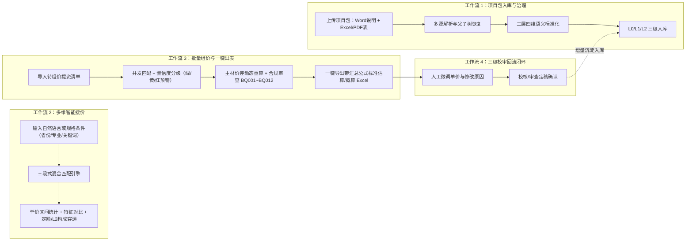

# 产品需求与业务闭环规格说明书（PRD）

> **关联文档**：[统一领域词汇表 (GLOSSARY.md)](../GLOSSARY.md) ｜ [架构契约与接缝规范](01-ARCHITECTURE-AND-CONTRACTS.md) ｜ [清单语义标准规范](02-BOQ-SEMANTIC-STANDARD-AND-ONTOLOGY.md)

---

## 一、 产品愿景与双轨目标

本系统（**BOQ Intelligence — 工程量清单语义标准及智能价格匹配平台**）围绕**“一线业务刚需提效”**与**“重点科技项目科研成果交付”**双轨目标进行工业级设计：

### 1.1 一线技经生产刚需
直接响应生态院工程经济所的真实一线诉求（见 [需求沟通截图](../data/1.png)）：
> “先建立一个数据库，比如按照省份、项目类型划分，下次有新项目，我们可以通过搜索找到最相似的项，直接调用单价出估算表。”

解决六大工程领域（水环境综合治理、城乡给排水、水利灌区、煤矿疏干水、土地综合整治、海洋生态修复）在传统造价模式下**专业提资格式异构（30%以上时间消耗在手工整理核对）、人工查定额套价周期长（3~5个工作日）、不同人员编制偏差大（8%~10%）**的痛点。

### 1.2 重点科技项目科研考核交付
对齐《公司重点科技项目申请表（2026.10—2028.12）》全部考核指标，以同一套结构化工程数据底座和可插拔算法平台支撑以下成果产出：
* **标准与知识资产**：《工程量清单特征分类体系》《工程标准化清单模板库》《工程量清单特征标注规范与操作指南》《造价历史数据治理与清洗报告》《工程量计算规则库》《工程价格数据库》。
* **算法与软件成果**：软件著作权 1 项、发明专利 1 项（《一种融合领域知识的工程量清单智能匹配方法》）、《智能匹配模型技术白皮书》《模型性能评估报告》。
* **学术论文**：SCI 论文 1 篇、中文核心期刊论文 1 篇。

---

## 二、 核心用户画像与职责矩阵

| 用户角色 | 典型代表 | 核心业务诉求 | 关键使用模块 |
| :--- | :--- | :--- | :--- |
| **造价编制工程师** | 一线技经人员（如项目编制人） | 1. 按省份/工程类型快速搜索历史相似清单与综合单价； 2. 导入新项目`待组价提资清单`，一键自动填充单价并导出标准估算/概算 Excel； 3. 一键穿透查看历史项的人/材/机与定额分析依据。 | 资产库浏览、智能搜价中心、批量组价出表工作台 |
| **造价校审专家 / 总工** | 校核人、审查人、技术总师（三级校审） | 1. 自动检出单位混用、合价算术错误、单价偏离历史均值异常与缺失核心特征项； 2. 在线调整单价并记录修改原因（如运距变化、施工条件变化）； 3. 审核定稿后触发`三级校审数据回流`，持续反哺价格库。 | 合规审查面板、三级校审工作台、主材调差面板 |
| **科研与算法工程师** | 科研与数字化中心、高校联合研发团队 | 1. 管理六大领域的 YAML 特征本体与正则/LLM 抽取插件； 2. 在同一测试基准上热插拔对比 `Hybrid`、`LSTM+Cosine`、`TransE/R-GCN` 等不同重排算法； 3. 导出准确率、MAPE 误差及消融实验报表用于论文与专利。 | 插件扩展框架、算法评测基准台、知识图谱浏览 |

---

## 三、 四大核心业务工作流（End-to-End User Journeys）

### 工作流 1：多源项目包自动化入库与清洗流
* **输入**：单个文件或成套`项目包`（例如 [西柳沟概算.docx](../data/西柳沟流域生态综合治理工程初步设计概算09.docx) + [西柳沟导表.xls](../data/西柳沟流域生态综合治理工程10.19单行本导表.xls)，或 [高明区预算.doc](../data/高明区明城镇全域土地综合整治项目（一标段.doc) + [高明区第四批次.xls](../data/高明区明城镇全域土地综合整治项目第四批次.xls)，或 [二级泵站电缆综合单价.pdf](../data/二级泵站电缆综合单价.pdf)）。
* **处理过程**：
  1. 自动嗅探文件格式与表头指纹，提取 Word 中的`项目宏观上下文 (L0)`（所在省区、价格基准期、定额依据、人工工日单价、取费费率与主材预算价）；
  2. 恢复 Excel/PDF 的`分部层级路径`、合并跨列表头、自动关联多 Sheet 中的 `L1 标准清单`、`L2 单价构成分析` 与 `主要材料价格表`；
  3. 调用语义标准化引擎拆解特征槽位并完成计量单位/金额量纲归一化（如 `万元` 统一为 `元`，`公顷`/`亩` 建立换算系数）；
  4. 在入库预览界面的五维质量评分通过后写入`工程价格数据库`与向量/BM25 索引。

### 工作流 2：多维分面检索与相似清单比价溯源流
* **输入**：按**省份/区县**、**六大工程领域**、**造价阶段**、**时间范围**筛选，并输入自然语言或复合规格查询（如 `"内蒙 沙柳 地径1cm 3年抚育"` 或 `"ZR-YJV 0.6/1KV 3*150"`）。
* **输出**：
  * 毫秒级返回按综合匹配得分排序的 Top-N 相似历史清单；
  * 顶部聚合统计卡片：历史综合单价**最低值、中位值、平均值、最高值**及样本数；
  * 逐项`匹配溯源与归因解释`：高亮对齐一致的硬规格槽位与差异项、展示 SHAP/AHP 特征贡献度权重、展示来源项目名称/编制年月/定额编号及人/材/机费用构成饼图。

### 工作流 3：待组价提资清单批量智能组价与一键出表（核心 MVP）
* **输入**：选择目标新项目的`项目宏观上下文 (L0)`（所在省份、工程领域、造价阶段、拟参照基准年月及可选地方最新主材信息价），上传`待组价提资清单`（Excel 标准模板或常规表头 Excel）。
* **处理过程**：
  1. 系统自动完成待组价清单的语义特征解析与量纲对齐；
  2. 对每条清单并发调用三段式混合匹配与动态调价引擎，填入推荐`综合单价`、`合价`与 Top-3 备选历史单价；
  3. **三级置信度红绿灯分级**：
     * 🟢 **高置信度（得分 $\ge 0.85$ 且硬规格无冲突）**：建议直接采纳；
     * 🟡 **中置信度（得分 $0.65 \sim 0.85$ 或存在次要特征/跨省跨期差异）**：提醒人工核对差异槽位或一键启用`主材价差动态重算`；
     * 🔴 **低置信度预警（得分 $< 0.65$ 或触发硬规格冲突惩罚）**：强制高亮提示“历史库缺乏同规格样本，请人工询价或补充套定额”。
  4. **自动合规审查**：同步运行 `BQ001~BQ012` 审查规则，自动标出单位错误、合价偏差、核心特征缺失与单价异常；
  5. **一键导出**：生成保留原始`分部层级路径`的标准化估算/概算 Excel 报表，内含自动求和（`SUM`）与乘积（`数量 × 单价`）原生 Excel 公式，支持“元 / 万元”口径切换，并附带“单价来源与调整说明”审价附表页。

### 工作流 4：三级校审与数据带原因回流闭环
* 编制人、校核人、审查人可在工作台界面对任意清单项切换备选单价或手工录入审定单价，并选择/填写`修改原因`（如“市场铜价上涨调差”、“地形坡度增加人工降效”）。
* 定稿审核通过后，系统将最终审定单价、原始推荐值、修改原因和审批人信息作为一条高质量标注记录写回`工程价格数据库`，同时支持触发局部向量索引与词典权重增量更新，形成“越用越准”的数据飞轮。

---

## 四、 功能优先级迭代矩阵

| 迭代阶段 | 优先级 | 核心功能范围 | 对应交付价值 |
| :--- | :--- | :--- | :--- |
| **Phase 1：MVP 核心闭环** | **P0（必须具备）** | 1. 现有 3 套真实数据（西柳沟水利、高明区土地整治、二级泵站电缆）全自动 ETL 解析入库； 2. 三大领域 YAML 特征本体与正则+LLM标准化抽取； 3. 混合检索 + 硬规格衰减核匹配引擎 + 溯源对比； 4. 按省/专业智能搜价 + 上传空白清单批量组价导出 Excel。 | **立即解决李永总提出的一线刚需**，跑通从“建库 → 搜价 → 出估算表”全流程。 |
| **Phase 2：工业深化与治理** | **P1（核心增强）** | 1. 扩展至全部六大工程领域 YAML 本体； 2. L2 单价构成分析穿透与`主材价差动态重算`； 3. `BQ001~BQ012` 合规与合理性审查引擎； 4. 三级校审意见记录与增量回流闭环； 5. 标准化提资清单模板下载与逆向校验。 | 满足《2024 清单计价标准》穿透式溯源与企业内控审价要求，支撑《数据治理报告》《规则库》《价格库》。 |
| **Phase 3：科研集成与验收** | **P2（科研深化）** | 1. 规则知识图谱可视化（工程类型—分部—清单—定额—主材）； 2. 可插拔算法消融实验评测台（Hybrid vs LSTM+Cosine vs TransE/R-GCN 一键跑分）； 3. SHAP 全局/局部特征归因图表导出与技术白皮书数据支撑。 | 直接产出论文对比实验图表、发明专利核心验证数据、软件著作权与《模型性能评估报告》。 |

---

## 五、 量化性能与质量验收指标（KPIs）

| 维度 | 指标名称 | 工业级验收红线 | 验证方式 |
| :--- | :--- | :--- | :--- |
| **解析准确率** | 多源样本解析完整率 | 对工作区 3 套跨格式样本（Word+XLS+PDF）清单行抽取完整率 $= 100\%$，金额误差 $< 0.01$ 元 | 自动化集成测试校验原始合价总额与入库总额一致性 |
| **规格防错配** | 硬规格冲突误召回率 | Top-1 推荐结果中核心规格冲突（如截面/运距/管径跨级错配）率 $= 0\%$（红灯拦截率 $100\%$） | 针对电缆截面、土方运距、苗木地径的专项对抗测试用例 |
| **匹配精度** | Top-3 相似清单命中率 | 历史库存在同类项时，Top-3 人工认可采纳率 $\ge 90\%$；同域预测单价平均绝对百分比误差（MAPE）$\le 8\%$ | 基于真实历史项目 5-Fold 交叉验证集统计 |
| **响应性能** | 批量组价吞吐耗时 | 单条实时搜索延迟 $< 200\text{ ms}$；一份 500 行`待组价提资清单`批量组价 + 合规审查总耗时 $< 3\text{ s}$（Tier-1 模式下） | 压测脚本基准测试 |
| **部署与扩展** | 离线可用性与插件化 | 100% 支持纯内网无外网环境离线运行（Regex + 本地向量模型）；新增文件解析器或审计规则不修改核心引擎代码 | 断网容器测试 + 插件代码静态依赖检查 |
