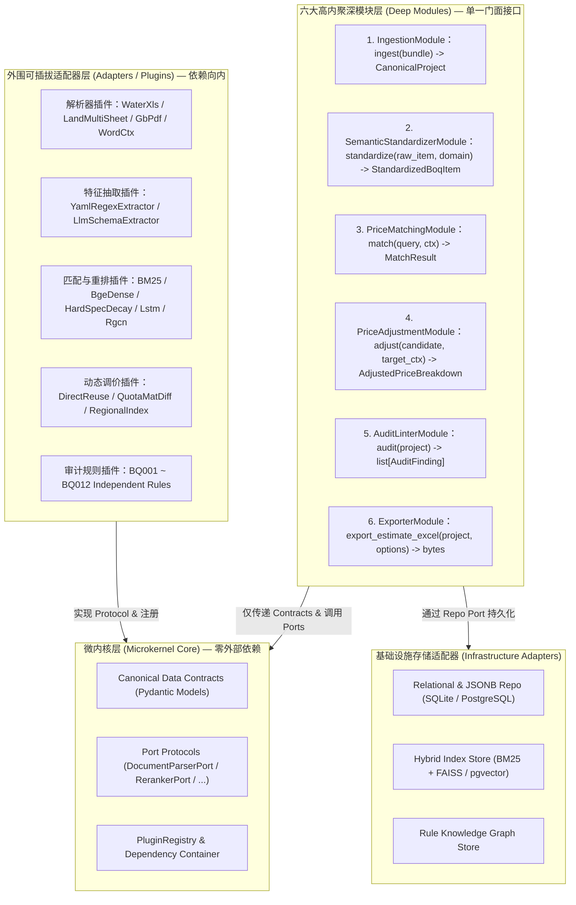

# 微内核深模块架构、标准数据契约与接缝规范

> **关联文档**：[统一领域词汇表 (GLOSSARY.md)](../GLOSSARY.md) ｜ [ADR-0001 微内核与深模块架构](adr/0001-microkernel-deep-modules-and-plugin-seams.md) ｜ [插件扩展开发手册](05-PLUGIN-EXTENSION-PLAYBOOK.md)

---

## 一、 架构设计总览（Deep Modules & Seams）

为确保系统在长期演进中保持**功能之间高内聚、模块之间低耦合、变化点极高可插拔性**，本系统遵循以下三条工程铁律：

1. **微内核与标准数据契约中心化**：`src/core/contracts/` 定义系统唯一通用的标准数据结构（Canonical Data Contracts），不含任何数据库驱动、Excel 解析库或深度学习框架依赖。
2. **六大深模块（Deep Modules）**：每个核心业务域收敛为一个高内聚深模块，对外仅暴露 **1 个极简门面接口**；所有的状态转换、重试降级、跨表聚合均封装在模块内部。
3. **单向依赖与接缝反转（Dependency Inversion at Seams）**：核心模块只在关键变化点定义抽象的 Python `Protocol` 接缝（Ports）；所有文件解析器、领域抽取器、匹配召回/重排算法、动态调价器、合规检查规则均作为外围适配器（Adapters）通过统一注册表（`PluginRegistry`）热插拔挂载。



---

## 二、 六大深模块职责与极简门面接口定义

| 深模块 | 核心职责（隐藏的内部复杂度） | 对外唯一门面接口签名 | 内部主要接缝（Seams） |
| :--- | :--- | :--- | :--- |
| **1. `IngestionModule`**<br/>文档摄入模块 | 识别文件指纹、调度对应解析插件、清洗空列与合并单元格、栈式恢复`分部层级路径`、关联报价表与单价分析表、注入 Word 宏观上下文。 | `ingest(bundle: ProjectFileBundle) -> CanonicalProject` | `DocumentParserPort` |
| **2. `SemanticStandardizerModule`**<br/>语义标准化模块 | 加载对应专业 YAML 领域特征本体、执行计量单位与金额量纲归一化、运行正则优先与 LLM 兜底特征槽位抽取、生成标准检索文本。 | `standardize(item: RawBoqItem, domain: str) -> StandardizedBoqItem` | `FeatureExtractorPort` |
| **3. `PriceMatchingModule`**<br/>智能匹配模块 | 执行知识路由过滤、调度多路召回并做 RRF 融合、运行重排插件与硬规格衰减核、生成三级置信度与 SHAP/AHP 可解释溯源结果。 | `match(query: StandardizedBoqItem, ctx: MatchContext) -> MatchResult` | `RetrieverPort`、`RerankerPort`、`ExplainerPort` |
| **4. `PriceAdjustmentModule`**<br/>动态调价模块 | 判断候选清单的数据颗粒度（是否有 L2 工料机分析）、匹配目标地最新主材价格、调度最优调价算子重算单价并记录调整公式明细。 | `adjust(candidate: MatchedCandidate, target_ctx: ProjectContext) -> AdjustedPriceBreakdown` | `PriceAdjusterPort` |
| **5. `AuditLinterModule`**<br/>合规审查模块 | 自动过滤章节小计行与说明行、并发执行所有已启用的 `BQ0xx` 审计规则插件、统计历史价格离散度并产出分级审查发现项。 | `audit(project: CanonicalProject) -> list[AuditFinding]` | `AuditRulePort` |
| **6. `ExporterModule`**<br/>导出与回流模块 | 按树状层级还原 Excel 样式、写入原生 `SUM` 与乘积动态公式、生成单价依据与合规审查附表、记录三级校审人工修正日志。 | `export_estimate_excel(project: CanonicalProject, options: ExportOptions) -> bytes` | `ExportTemplatePort` |

---

## 三、 标准数据契约（Canonical Data Contracts）

所有跨模块、跨插件通信严格使用以下基于 `Pydantic v2` 的强类型数据契约模型（位于 `src/core/contracts/`），任何模块不得私自修改入参对象，均以返回值返回新状态。

### 3.1 项目包与宏观上下文契约（`project.py`）

```python
from datetime import datetime
from enum import Enum
from pathlib import Path
from typing import Optional
from pydantic import BaseModel, Field


class CostStage(str, Enum):
    ESTIMATE = "投资估算"
    PRELIMINARY_DESIGN = "初步设计概算"
    CONSTRUCTION_DRAWING = "施工图预算"
    BID_CONTROL = "招标控制价"
    BID_QUOTE = "投标报价"
    SETTLEMENT = "竣工结算"


class EngineeringDomain(str, Enum):
    WATER_ECOLOGY = "01_water_ecology"          # 水环境综合治理工程
    URBAN_WATER = "02_urban_water"              # 城乡给排水工程
    IRRIGATION = "03_irrigation"                # 水利灌区工程
    COAL_MINE_WATER = "04_coal_mine_water"      # 煤矿疏干水工程
    LAND_CONSOLIDATION = "05_land_consolidation"# 全域土地综合整治工程
    MARINE_ECOLOGY = "06_marine_ecology"        # 海洋生态修复工程
    INSTALLATION_GENERAL = "07_installation"    # 通用安装配套工程（如二级泵站电缆）


class ProjectFileBundle(BaseModel):
    """文档摄入模块的唯一输入契约：支持成套项目文件聚合解析"""
    project_name: Optional[str] = None
    domain_hint: Optional[EngineeringDomain] = None
    files: list[Path]
    province_hint: Optional[str] = None
    price_base_month_hint: Optional[str] = None  # 格式: YYYY-MM


class MaterialPriceRecord(BaseModel):
    """主要材料基准价契约"""
    material_code: Optional[str] = None
    material_name: str
    spec_model: Optional[str] = None
    unit: str
    base_price: Optional[float] = None          # 定额规定基价（元）
    budget_price_excl_tax: Optional[float] = None # 除税预算价/市场信息价（元）
    tax_included: bool = False
    region: Optional[str] = None
    price_month: Optional[str] = None


class FeeRateRule(BaseModel):
    """工程类别取费费率契约"""
    engineering_category: str                   # 如: 土方工程 / 石方工程 / 砌筑工程
    temp_facility_rate: Optional[float] = None
    indirect_fee_base: str = "直接费"           # 直接费 或 人工费
    indirect_fee_rate: Optional[float] = None
    profit_rate: Optional[float] = None
    tax_rate: Optional[float] = None


class ProjectContext(BaseModel):
    """L0 项目宏观上下文契约"""
    project_id: str
    project_name: str
    domain: EngineeringDomain
    province: str
    city: Optional[str] = None
    district: Optional[str] = None
    stage: CostStage
    price_base_month: str                       # 如 "2026-07" 或 "2025-07"
    quota_standards: list[str] = Field(default_factory=list)
    labor_rates: dict[str, float] = Field(default_factory=dict)  # 如 {"甲类工": 107.1, "乙类工": 76.7}
    utility_rates: dict[str, float] = Field(default_factory=dict)# 如 {"电": 0.87, "风": 0.32, "水": 11.47}
    fee_rules: list[FeeRateRule] = Field(default_factory=list)
    base_materials: list[MaterialPriceRecord] = Field(default_factory=list)
    total_investment_yuan: Optional[float] = None
    source_files: list[str] = Field(default_factory=list)
    created_at: datetime = Field(default_factory=datetime.utcnow)
```

### 3.2 清单、语义特征与单价构成契约（`boq_item.py`）

```python
from enum import Enum
from typing import Any, Optional
from pydantic import BaseModel, Field


class FeatureDimension(str, Enum):
    ENTITY_SPEC = "entity_spec"     # 实体材质与规格特征
    PROCESS_WORK = "process_work"   # 施工工艺与工作内容特征
    ENV_CONDITION = "env_condition" # 环境与工况特征


class FeatureSlotValue(BaseModel):
    """结构化特征槽位值"""
    slot_key: str                   # 规范槽位键，如 "cable_cross_section" / "haul_distance_km"
    slot_label: str                 # 中文标签，如 "芯数与截面积" / "运距(km)"
    dimension: FeatureDimension
    raw_text: str                   # 原始提取片段
    normalized_value: Any           # 标准化值（字符串、数值或区间对象）
    numeric_value: Optional[float] = None  # 提取出的基准标量值（用于硬规格衰减核计算）
    numeric_unit: Optional[str] = None
    hard_constraint: bool = False   # 是否为硬约束规格槽位
    ahp_weight: float = 0.0         # 该槽位在所属分类中的 AHP 权重
    extractor_source: str = "regex" # "regex" | "llm" | "manual"


class QuotaResourceLine(BaseModel):
    """L2 单价构成中的单条工料机消耗"""
    resource_type: str              # "人工" | "材料" | "机械" | "价差" | "取费"
    name: str
    spec: Optional[str] = None
    unit: str
    quantity: float
    unit_price: float
    subtotal: float


class UnitPriceBreakdown(BaseModel):
    """L2 单价构成分析契约"""
    quota_codes: list[str] = Field(default_factory=list)  # 如 ["10347", "10360"]
    quota_unit: Optional[str] = None
    direct_labor_fee: Optional[float] = None
    direct_material_fee: Optional[float] = None
    direct_machinery_fee: Optional[float] = None
    other_direct_fee: Optional[float] = None
    indirect_fee: Optional[float] = None
    profit_fee: Optional[float] = None
    tax_fee: Optional[float] = None
    resource_lines: list[QuotaResourceLine] = Field(default_factory=list)


class RawBoqItem(BaseModel):
    """原始清单项契约（解析器插件统一输出此格式）"""
    seq_no: str
    section_path: list[str]         # 分部层级路径，如 ["光明东片区", "土地平整工程", "地表清理工程"]
    is_section_header: bool = False # 是否为纯汇总/章节标题行
    boq_code: Optional[str] = None  # 12位国标码或工程编码
    raw_name: str
    raw_features: str = ""
    raw_work_content: str = ""
    raw_unit: Optional[str] = None
    quantity: Optional[float] = None
    unit_price_yuan: Optional[float] = None   # 统一换算为元
    total_price_yuan: Optional[float] = None  # 统一换算为元（导表为万元时自动×10000）
    breakdown: Optional[UnitPriceBreakdown] = None
    source_sheet: Optional[str] = None
    source_row: Optional[int] = None


class StandardizedBoqItem(BaseModel):
    """L1 标准清单项契约（SemanticStandardizerModule 输出）"""
    item_id: str
    project_id: str
    domain: str
    category_code: str              # 对齐 YAML 本体二级分类码
    standard_name: str              # 归一化主名称（如 "电力电缆" / "土石方运输" / "黑沙蒿栽植"）
    boq_code: Optional[str] = None
    section_path: list[str]
    raw_text_full: str              # 拼接后的完整原文
    canonical_search_text: str      # 供 BM25/Dense 向量编码的标准化文本
    standard_unit: Optional[str] = None
    unit_conversion_factor: float = 1.0       # 原单位到标准单位换算系数
    normalized_quantity: Optional[float] = None
    normalized_unit_price_yuan: Optional[float] = None
    total_price_yuan: Optional[float] = None
    slots: dict[str, FeatureSlotValue] = Field(default_factory=dict)
    breakdown: Optional[UnitPriceBreakdown] = None
    quality_score: float = 1.0


class CanonicalProject(BaseModel):
    """跨模块传递的标准项目聚合根契约"""
    context: ProjectContext
    items: list[StandardizedBoqItem] = Field(default_factory=list)
    raw_items_count: int = 0
    audit_findings: list[Any] = Field(default_factory=list)
```

### 3.3 智能匹配、动态调价与合规审查契约（`matching.py`）

```python
from enum import Enum
from typing import Any, Optional
from pydantic import BaseModel, Field


class ConfidenceLevel(str, Enum):
    HIGH = "high"       # >= 0.85 且无硬规格冲突（绿色）
    MEDIUM = "medium"   # 0.65 ~ 0.85（黄色）
    LOW = "low"         # < 0.65 或存在硬规格冲突（红色预警）


class MatchContext(BaseModel):
    """匹配请求上下文"""
    target_project_ctx: Optional[ProjectContext] = None
    preferred_provinces: list[str] = Field(default_factory=list)
    preferred_domains: list[str] = Field(default_factory=list)
    top_k: int = 5
    pipeline_name: str = "production_hybrid" # 支持切换 "lstm_baseline" / "rgcn_experiment"


class SlotComparison(BaseModel):
    """目标清单与历史候选清单在单个特征槽位上的逐项对比"""
    slot_key: str
    slot_label: str
    query_value: Any
    candidate_value: Any
    similarity: float
    contribution_weight: float      # SHAP/AHP 归因贡献值
    is_hard_conflict: bool = False


class ExplainAttribution(BaseModel):
    """可解释性溯源与归因结果"""
    slot_comparisons: list[SlotComparison] = Field(default_factory=list)
    feature_contributions: dict[str, float] = Field(default_factory=dict) # 各维度贡献占比
    provenance_project_name: str
    provenance_province: str
    provenance_month: str
    provenance_stage: str
    provenance_quota_codes: list[str] = Field(default_factory=list)
    summary_reason: str


class MatchedCandidate(BaseModel):
    """单条匹配候选结果"""
    candidate_item: StandardizedBoqItem
    candidate_project_ctx: ProjectContext
    raw_bm25_score: float = 0.0
    raw_dense_score: float = 0.0
    hard_spec_kernel_score: float = 1.0
    final_score: float
    confidence: ConfidenceLevel
    has_hard_spec_conflict: bool = False
    attribution: ExplainAttribution


class AdjustedPriceBreakdown(BaseModel):
    """动态调价结果契约"""
    adjuster_used: str              # "direct_reuse" | "quota_material_diff" | "regional_index"
    original_unit_price_yuan: float
    adjusted_unit_price_yuan: float
    adjustment_factor: float = 1.0
    price_diff_details: list[str] = Field(default_factory=list) # 如 ["柴油: 7.00 -> 7.40元/kg"]


class MatchResult(BaseModel):
    """PriceMatchingModule 的唯一输出契约"""
    query_item_id: str
    recommended_unit_price_yuan: Optional[float] = None
    confidence: ConfidenceLevel
    candidates: list[MatchedCandidate] = Field(default_factory=list)
    adjusted_price: Optional[AdjustedPriceBreakdown] = None
    warning_messages: list[str] = Field(default_factory=list)


class AuditSeverity(str, Enum):
    ERROR = "error"
    WARNING = "warning"
    NOTICE = "notice"


class AuditFinding(BaseModel):
    """合规与合理性审查发现项契约"""
    rule_id: str                    # 如 "BQ001"
    rule_name: str
    severity: AuditSeverity
    item_id: Optional[str] = None
    seq_no: Optional[str] = None
    message: str
    suggestion: Optional[str] = None


class ExportOptions(BaseModel):
    """报表导出配置"""
    currency_unit: str = "元"       # "元" | "万元"
    include_formula: bool = True    # 是否写入原生 Excel 乘积与求和公式
    include_audit_sheet: bool = True
    include_provenance_sheet: bool = True
```

---

## 四、 五大可插拔接缝协议（Port Protocols）与注册表机制

所有需要后期扩展或学术对比替换的能力，都在 `src/core/ports/` 中定义为 Python `typing.Protocol`（结构化子类型接口）。

```python
from pathlib import Path
from typing import Optional, Protocol, runtime_checkable
from pydantic import BaseModel, Field
from src.core.contracts.project import (
    CostStage,
    EngineeringDomain,
    FeeRateRule,
    MaterialPriceRecord,
    ProjectContext,
    ProjectFileBundle,
)
from src.core.contracts.boq_item import (
    CanonicalProject,
    FeatureSlotValue,
    RawBoqItem,
    StandardizedBoqItem,
)
from src.core.contracts.matching import (
    AuditFinding,
    AuditSeverity,
    AdjustedPriceBreakdown,
    MatchContext,
    MatchedCandidate,
    ExplainAttribution,
)


class PartialContext(BaseModel):
    """单个解析器插件抽取出的局部项目上下文，由 IngestionModule 负责合并"""
    source_file: str
    project_name: Optional[str] = None
    domain: Optional[EngineeringDomain] = None
    province: Optional[str] = None
    city: Optional[str] = None
    district: Optional[str] = None
    stage: Optional[CostStage] = None
    price_base_month: Optional[str] = None
    quota_standards: list[str] = Field(default_factory=list)
    labor_rates: dict[str, float] = Field(default_factory=dict)
    utility_rates: dict[str, float] = Field(default_factory=dict)
    fee_rules: list[FeeRateRule] = Field(default_factory=list)
    base_materials: list[MaterialPriceRecord] = Field(default_factory=list)
    total_investment_yuan: Optional[float] = None


@runtime_checkable
class DocumentParserPort(Protocol):
    """接缝 1：文档摄入解析插件接口"""
    parser_id: str

    def can_handle(self, file_path: Path, header_preview: list[str]) -> bool:
        """通过扩展名与表头指纹判断是否由本插件解析"""
        ...

    def parse(self, file_path: Path, bundle_ctx: ProjectFileBundle) -> tuple[PartialContext, list[RawBoqItem]]:
        """解析文档返回局部项目上下文与原始清单行"""
        ...


@runtime_checkable
class FeatureExtractorPort(Protocol):
    """接缝 2：语义特征槽位抽取插件接口"""
    extractor_id: str
    priority: int  # 10=正则本体优先, 90=LLM强类型兜底

    def extract(self, raw_item: RawBoqItem, ontology: dict) -> dict[str, FeatureSlotValue]:
        ...


@runtime_checkable
class RetrieverPort(Protocol):
    """接缝 3A：多路召回插件接口 (BM25 / Dense / KG)"""
    retriever_id: str

    def retrieve(self, query: StandardizedBoqItem, ctx: MatchContext, top_n: int) -> list[tuple[str, float]]:
        """返回 (candidate_item_id, raw_score) 列表"""
        ...


@runtime_checkable
class RerankerPort(Protocol):
    """接缝 3B：重排打分插件接口 (HybridKernel / LSTM / R-GCN)"""
    reranker_id: str

    def score(
        self,
        query: StandardizedBoqItem,
        candidates: list[tuple[StandardizedBoqItem, ProjectContext]],
        ctx: MatchContext,
    ) -> list[MatchedCandidate]:
        ...


@runtime_checkable
class ExplainerPort(Protocol):
    """接缝 3C：可解释归因插件接口"""
    explainer_id: str

    def explain(self, query: StandardizedBoqItem, candidate: MatchedCandidate) -> ExplainAttribution:
        ...


@runtime_checkable
class PriceAdjusterPort(Protocol):
    """接缝 4：跨区域跨期动态调价算子接口"""
    adjuster_id: str

    def supports(self, candidate: MatchedCandidate, target_ctx: ProjectContext) -> bool:
        ...

    def adjust(self, candidate: MatchedCandidate, target_ctx: ProjectContext) -> AdjustedPriceBreakdown:
        ...


@runtime_checkable
class AuditRulePort(Protocol):
    """接缝 5：造价合规与合理性审查规则插件接口"""
    rule_id: str
    rule_name: str
    default_severity: AuditSeverity

    def check(self, project: CanonicalProject, historical_stats: dict) -> list[AuditFinding]:
        ...
```

### 插件注册表（`PluginRegistry`）工作机制
位于 `src/core/registry.py`。应用启动时自动扫描各模块 `adapters/` 与 `rules/` 目录，所有带 `@PluginRegistry.register("parsers")`、`@PluginRegistry.register("rerankers")`、`@PluginRegistry.register("audit_rules")` 装饰器的类自动注入对应接口池，由 `configs/pipelines.yaml` 声明式指定当前激活的策略链。

---

## 五、 工程目录结构规范

```text
boq-engine/
├── configs/
│   ├── domains/                      # 【热插拔领域本体】六大工程专业 YAML 配置
│   │   ├── 01_water_ecology.yaml
│   │   ├── 02_urban_water.yaml
│   │   ├── 03_irrigation.yaml
│   │   ├── 04_coal_mine_water.yaml
│   │   ├── 05_land_consolidation.yaml
│   │   ├── 06_marine_ecology.yaml
│   │   └── 07_installation.yaml
│   └── pipelines.yaml                # 线上/实验匹配流水线与审查规则开关配置
├── src/
│   ├── core/                         # 【微内核层：绝对稳定，零第三方业务库依赖】
│   │   ├── contracts/                # project.py, boq_item.py, matching.py
│   │   ├── ports/                    # 5 大接缝 Protocol 定义
│   │   └── registry.py               # 插件注册表与装配工厂
│   ├── modules/                      # 【六大高内聚深模块】
│   │   ├── ingestion/
│   │   │   ├── service.py            # IngestionModule
│   │   │   └── adapters/             # water_xls, land_multisheet, gb_pdf, word_ctx
│   │   ├── standardizer/
│   │   │   ├── service.py            # SemanticStandardizerModule
│   │   │   ├── unit_converter.py     # 量纲与单位换算矩阵
│   │   │   └── adapters/             # yaml_regex_extractor, llm_schema_extractor
│   │   ├── matching/
│   │   │   ├── service.py            # PriceMatchingModule
│   │   │   ├── retrievers/           # bm25_retriever, bge_dense_retriever, kg_router
│   │   │   ├── rerankers/            # hybrid_kernel_reranker, lstm_reranker, rgcn_reranker
│   │   │   └── explainers/           # shap_ahp_explainer
│   │   ├── pricing/
│   │   │   ├── service.py            # PriceAdjustmentModule
│   │   │   └── adapters/             # direct_reuse, quota_material_diff, regional_index
│   │   ├── auditing/
│   │   │   ├── service.py            # AuditLinterModule
│   │   │   └── rules/                # bq001_missing_fields ... bq012_outlier_price
│   │   └── exporter/
│   │       └── service.py            # ExporterModule (Excel 生成与三审回流)
│   ├── infrastructure/               # 【基础设施适配器】
│   │   ├── repositories/             # sqlite_repo.py / postgres_repo.py / memory_repo.py
│   │   └── vector_store/             # numpy_faiss_store.py / pgvector_store.py
│   └── api/                          # 【FastAPI 接口服务与 Web 前端入口】
│       ├── main.py
│       └── routes/
└── tests/                            # 【面向深模块门面接口的契约测试】
    ├── contracts/
    ├── modules/
    └── fixtures/                     # 基于 data/ 真实项目脱敏切分片段
```
