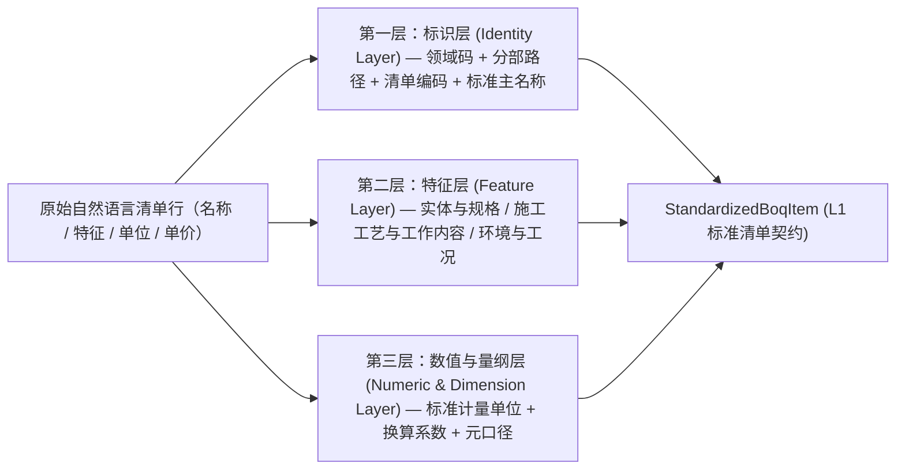

# 工程量清单特征分类体系与语义标注规范

> **关联文档**：[统一领域词汇表 (GLOSSARY.md)](../GLOSSARY.md) ｜ [架构契约与接缝规范](01-ARCHITECTURE-AND-CONTRACTS.md) ｜ [ADR-0002 YAML 领域本体驱动](adr/0002-yaml-ontology-plus-hybrid-regex-llm-extraction.md)
> **科研对应交付物**：《工程量清单特征分类体系》《工程量清单特征标注规范与操作指南（技术手册）》

---

## 一、 “三层四维”工程量清单语义标准模型

针对水环境综合治理、城乡给排水、水利灌区、煤矿疏干水、土地综合整治、海洋生态修复及通用安装配套等工程领域提资格式异构、自然语言描述随意、特征要素混写等问题，本规范建立**“三层四维”工程量清单语义标准模型**，将机器不可读的自然语言清单一律映射为标准化的结构化表达。



### 1.1 第一层：标识层（Identity Layer）
唯一锚定清单项的工程专业归属与标准名称，解决“同物异名、编码缺失”的问题：
* **一级工程领域编码**：
  * `01_water_ecology`：水环境综合治理工程（河道生态修复、湿地、生态护岸等，如 [西柳沟项目](../data/西柳沟流域生态综合治理工程10.19单行本导表.xls)）
  * `02_urban_water`：城乡给排水工程（厂站构筑物、排水管网、生活污水治理等）
  * `03_irrigation`：水利灌区工程（渠道衬砌、闸站、输水管道等）
  * `04_coal_mine_water`：煤矿疏干水工程（矿井水处理、高承压管网、加压泵站等）
  * `05_land_consolidation`：全域土地综合整治工程（土地平整、表土剥离、农田水利、耕地恢复等，如 [高明区项目](../data/高明区明城镇全域土地综合整治项目第四批次.xls)）
  * `06_marine_ecology`：海洋生态修复工程（红树林种植、海岸带修复、人工鱼礁等）
  * `07_installation`：通用安装配套工程（工业泵站电气电缆、自控仪表等，如 [二级泵站电缆项目](../data/二级泵站电缆综合单价.pdf)）
* **分部层级路径（Section Breadcrumb Path）**：从工程分部树提取的路径数组（如 `["河道滩地生态修复工程", "灌木"]` 或 `["光明东片区", "土地平整工程", "地表清理工程"]`）。
* **标准主名称归一化字典**：建立同义主名称归并表，例如将 `清表，推土机推土`、`表土清理`、`地表清理` 统一归并为标准主名称 `地表清理`；将 `接地铜排`、`接地母线` 关联归类；将 `黑沙蒿`、`北沙柳`、`柠条` 归类至标准主名称 `灌木栽植`。

### 1.2 第二层：特征层（Feature Layer — 三大核心维度）
将混杂在名称列或 `[项目特征]`/`[工作内容]` 中的自然语言拆解为三个正交维度的键值对槽位（Slots），并区分**硬约束规格槽位**与**软语义特征**：

1. **维度 A：实体材质与规格特征（`entity_spec`）**
   描述工程实体本身的物理材料、型号、几何尺寸与力学/电气性能。例如：植物品种（黑沙蒿）、地径（$\ge 0.3\text{ cm}$）、株高（$25\sim 30\text{ cm}$）、电缆型号（`ZR-YJV`）、额定电压（`0.6/1KV`）、芯数截面积（`3×150+1×95`）、混凝土强度等级（`C30`）、管径（`φ600mm`）。
2. **维度 B：施工工艺与工作内容特征（`process_work`）**
   描述完成该实体所采取的施工方法、配套作业及机械类型。例如：敷设方式（`室内`）、电缆工作内容（`电缆敷设 + 电缆头制作及安装`）、种植密度与形式（`1m×3m, 220株/亩`）、栽植坑尺寸（`30cm×30cm×30cm`）、机械功率（`推土机 59kW`）。
3. **维度 C：环境与工况特征（`env_condition`）**
   描述外部地形、运距、气候及管护周期等工况边界。例如：土石方运距（`5km` / `0.5km` / `80m`）、苗木抚育养护期（`3年`）、安装环境（`户内` / `户外`）、土石方类别（`原土` / `表土`）。

### 1.3 第三层：数值与量纲层（Numeric & Dimension Layer）
消除不同造价软件导表在单位和金额口径上的量纲差异（“四维统一”中的量纲维度）：

| 物理量类别 | 原始常见异构写法 | 标准归一化单位 | 自动换算系数 ($k$) | 换算公式 |
| :--- | :--- | :--- | :--- | :--- |
| **长度** | `m`、`米`、`延长米` / `km` | `m` | `1.0` / `1000.0` | $Q_{\text{std}} = Q_{\text{raw}} \times k$ |
| **面积** | `m²`、`㎡`、`m2` / `hm²`、`公顷` / `亩` | `m²`（生态绿化大面可保留 `hm²` 并双向转换） | `1.0` / `10000.0` / `666.6667` | $1\text{ hm}^2 = 15\text{ 亩} = 10000\text{ m}^2$ |
| **体积** | `m³`、`立方米`、`100m³` | `m³` | `1.0` / `100.0` | 如定额单位 `100m³` 自动除以 `100` 得单方单价 |
| **数量** | `株`、`棵` / `100棵` / `千块` | `株(棵)` / `块` | `1.0` / `100.0` / `1000.0` | 如 `100棵` 换算为单棵综合单价 |
| **金额口径** | `元` / `万元` | `元` | `1.0` / `10000.0` | `西柳沟导表` 合价列为 `万元`，入库强制转为 `元` |

---

## 二、 六大工程领域三级特征分类体系与 AHP 特征权重矩阵

结合《公司重点科技项目申报书》中规定的德尔菲法与层次分析法（AHP），对六大核心领域（及通用安装配套）建立三级特征分类体系与特征权重矩阵（每个分类内各槽位权重之和严格满足 $\sum w_i = 1.00$，判断矩阵一致性比率 $CR < 0.10$）：

| 工程领域（一级） | 典型分部类别（二级） | 核心特征槽位（三级） | 维度归属 | 是否硬约束槽位 | AHP 权重 ($w_i$) |
| :--- | :--- | :--- | :--- | :---: | :---: |
| **01 水环境综合治理**<br/>**03 水利灌区** | 植被恢复与生态绿化<br/>（灌木/草地栽植） | `species`（植物/草籽品种及混播比）<br/>`stem_diameter_cm`（地径/胸径规格）<br/>`plant_height_cm`（株高/冠幅）<br/>`planting_density`（株行距/密度/播量）<br/>`care_years`（抚育养护年限）<br/>`pit_size_cm`（栽植坑尺寸） | `entity_spec`<br/>`entity_spec`<br/>`entity_spec`<br/>`process_work`<br/>`env_condition`<br/>`process_work` | **是**<br/>**是**<br/>否<br/>否<br/>**是**<br/>否 | `0.30`<br/>`0.25`<br/>`0.10`<br/>`0.15`<br/>`0.12`<br/>`0.08` |
| **01 水环境综合治理**<br/>**03 水利灌区** | 河道护岸与防冲刷<br/>（格宾石笼/浆砌石） | `structure_material`（网箱材质/镀层/石料）<br/>`mesh_wire_spec`（网孔尺寸与丝径）<br/>`thickness_or_section`（护坡厚度/断面）<br/>`mortar_grade`（砂浆/混凝土标号） | `entity_spec`<br/>`entity_spec`<br/>`entity_spec`<br/>`entity_spec` | **是**<br/>**是**<br/>**是**<br/>**是** | `0.35`<br/>`0.25`<br/>`0.25`<br/>`0.15` |
| **05 全域土地综合整治** | 土石方开挖、清表、平整与运输 | `operation_type`（作业类型：清表/剥离/回填/运输）<br/>`haul_distance_m`（运距/推距，统一折算米）<br/>`soil_class`（土石方级别/原土/表土）<br/>`layer_thickness_m`（清表或覆土厚度）<br/>`machinery_spec`（主要施工机械规格/功率） | `process_work`<br/>`env_condition`<br/>`env_condition`<br/>`entity_spec`<br/>`process_work` | **是**<br/>**是**<br/>否<br/>**是**<br/>否 | `0.32`<br/>`0.35`<br/>`0.12`<br/>`0.11`<br/>`0.10` |
| **02 城乡给排水**<br/>**04 煤矿疏干水** | 管道敷设、构筑物混凝土与水处理设备 | `pipe_material`（管材：HDPE/球墨铸铁/钢塑/PE）<br/>`nominal_diameter_mm`（公称直径 DN / 外径）<br/>`pressure_rating_mpa`（公称压力 PN / 环刚度 SN）<br/>`burial_depth_m` / `trench_condition`（埋深/土质）<br/>`joint_method`（连接方式：电熔/承插/焊接） | `entity_spec`<br/>`entity_spec`<br/>`entity_spec`<br/>`env_condition`<br/>`process_work` | **是**<br/>**是**<br/>**是**<br/>否<br/>否 | `0.28`<br/>`0.35`<br/>`0.17`<br/>`0.12`<br/>`0.08` |
| **06 海洋生态修复** | 海岸带修复、红树林营造与人工鱼礁 | `habitat_species` / `reef_type`（品种或礁体结构）<br/>`tidal_zone_condition`（潮间带/水深工况）<br/>`seedling_spec` / `concrete_grade`（苗龄高度/抗腐蚀标号）<br/>`protection_years`（管护与监测周期） | `entity_spec`<br/>`env_condition`<br/>`entity_spec`<br/>`env_condition` | **是**<br/>**是**<br/>**是**<br/>否 | `0.35`<br/>`0.28`<br/>`0.25`<br/>`0.12` |
| **07 通用安装配套**<br/>（泵站电气与自控） | 电力电缆、控制电缆、终端头及接地 | `cable_model`（型号前缀：ZR-YJV/ZR-KVVP/DJYVP）<br/>`voltage_kv`（额定电压等级：8.7/10KV, 0.6/1KV）<br/>`cross_section_eq_mm2`（主芯+地芯等效截面积）<br/>`install_location`（敷设方式/场所：室内/户内/户外）<br/>`work_content_flags`（工作内容：含终端头制作与否） | `entity_spec`<br/>`entity_spec`<br/>`entity_spec`<br/>`env_condition`<br/>`process_work` | **是**<br/>**是**<br/>**是**<br/>**是**<br/>否 | `0.22`<br/>`0.18`<br/>`0.42`<br/>`0.10`<br/>`0.08` |

> **关键设计说明**：上表中`电缆芯数与截面积`（`cross_section_eq_mm2`）的 AHP 权重高达 `0.42` 且设为硬约束槽位。原因在于 `3×150+1×95` 总截面积为 $545\text{ mm}^2$，而 `3×25+1×16` 总截面积仅为 $91\text{ mm}^2$，导体的用铜量直接决定了电缆综合单价的量级差异。

---

## 三、 基于工作区真实工程数据的标准化标注实证示例库

以下 3 个标注样例全部取自工作区 `data/` 目录下的真实文件，展示了从**异构原始行**到**`StandardizedBoqItem` 标准结构**的完整映射。

### 实证样例 1：水利与水环境生态治理（来自 `西柳沟流域生态综合治理工程10.19单行本导表.xls` Row 6）

* **原始数据行**：
  * `分部上下文`：`第一部分 建筑工程` → `1 西柳沟流域生态综合治理工程` → `1.1 河道滩地生态修复工程` → `1.1.1 灌木`
  * `序号`：`1.1.1.1`
  * `工程或费用名称`：`黑沙蒿规格：地径≥0.3cm， 高度 25 ~ 30 cm。种植形式 ：1m×3m标准：220株/亩栽植 坑：30cm×30cm×30cm抚育 ：3年`
  * `单位`：`hm²` ｜ `数量`：`3.41` ｜ `单价（元）`：`13823.75` ｜ `合计（万元）`：`4.71`
* **标准化标注结果（JSON）**：

```json
{
  "domain": "01_water_ecology",
  "category_code": "01_02_shrub_planting",
  "standard_name": "灌木栽植-黑沙蒿",
  "section_path": ["第一部分 建筑工程", "西柳沟流域生态综合治理工程", "河道滩地生态修复工程", "灌木"],
  "standard_unit": "hm²",
  "unit_conversion_factor": 1.0,
  "normalized_quantity": 3.41,
  "normalized_unit_price_yuan": 13823.75,
  "total_price_yuan": 47100.0,
  "slots": {
    "species": {
      "slot_label": "植物品种",
      "dimension": "entity_spec",
      "raw_text": "黑沙蒿",
      "normalized_value": "黑沙蒿",
      "hard_constraint": true,
      "ahp_weight": 0.30
    },
    "stem_diameter_cm": {
      "slot_label": "地径(cm)",
      "dimension": "entity_spec",
      "raw_text": "地径≥0.3cm",
      "normalized_value": {"min": 0.3, "op": ">="},
      "numeric_value": 0.3,
      "numeric_unit": "cm",
      "hard_constraint": true,
      "ahp_weight": 0.25
    },
    "plant_height_cm": {
      "slot_label": "高度(cm)",
      "dimension": "entity_spec",
      "raw_text": "高度 25 ~ 30 cm",
      "normalized_value": {"min": 25.0, "max": 30.0},
      "numeric_value": 27.5,
      "numeric_unit": "cm",
      "hard_constraint": false,
      "ahp_weight": 0.10
    },
    "planting_density": {
      "slot_label": "种植形式与标准",
      "dimension": "process_work",
      "raw_text": "1m×3m标准：220株/亩",
      "normalized_value": "行距1m×株距3m(220株/亩)",
      "numeric_value": 220.0,
      "numeric_unit": "株/亩",
      "hard_constraint": false,
      "ahp_weight": 0.15
    },
    "pit_size_cm": {
      "slot_label": "栽植坑尺寸",
      "dimension": "process_work",
      "raw_text": "30cm×30cm×30cm",
      "normalized_value": "30×30×30cm",
      "hard_constraint": false,
      "ahp_weight": 0.08
    },
    "care_years": {
      "slot_label": "抚育年限(年)",
      "dimension": "env_condition",
      "raw_text": "抚育 ：3年",
      "normalized_value": 3,
      "numeric_value": 3.0,
      "numeric_unit": "年",
      "hard_constraint": true,
      "ahp_weight": 0.12
    }
  }
}
```

### 实证样例 2：全域土地综合整治（来自 `高明区明城镇全域土地综合整治项目第四批次.xls` 跨表联动）

* **原始数据行**：
  * `报价表 Row 11`：`1.1.1.2.2 | 土（石）方运输，运距5km | m³ | 1975.8 | 21.63 | 42736.55`
  * `祖先层级路径`：`1 光明东片区` → `1.1 土地平整工程` → `1.1.1 地表清理工程` → `1.1.1.2 地表清理 0.05m厚`
  * `单价汇总表 Row 4`：人工费 `0.72`、机械费 `14.15`
  * `清单单价分析表4 Row 31-54`：定额 `10224`（`100m³`），含甲类工 `0.09工日`、乙类工 `0.79工日`、1m³挖掘机 `0.19台班`、59kW推土机 `0.14台班`、5t自卸汽车 `2.75台班`、柴油价差 `127.56kg × 2.5元/kg = 318.89元`、措施费 `3.6%`、间接费 `5%`、利润 `3%`、税金 `9%`，合价 `2162.90 元/100m³`（即 `21.63 元/m³`）。
* **标准化标注结果（JSON 核心片段）**：

```json
{
  "domain": "05_land_consolidation",
  "category_code": "05_01_earthwork_transport",
  "standard_name": "土石方运输",
  "section_path": ["光明东片区", "土地平整工程", "地表清理工程", "地表清理 0.05m厚"],
  "standard_unit": "m³",
  "normalized_quantity": 1975.8,
  "normalized_unit_price_yuan": 21.63,
  "total_price_yuan": 42736.55,
  "slots": {
    "operation_type": {
      "slot_label": "作业类型",
      "dimension": "process_work",
      "raw_text": "土（石）方运输",
      "normalized_value": "土石方运输",
      "hard_constraint": true,
      "ahp_weight": 0.32
    },
    "haul_distance_m": {
      "slot_label": "运距(m)",
      "dimension": "env_condition",
      "raw_text": "运距5km",
      "normalized_value": 5000.0,
      "numeric_value": 5000.0,
      "numeric_unit": "m",
      "hard_constraint": true,
      "ahp_weight": 0.35
    },
    "machinery_spec": {
      "slot_label": "主要机械规格",
      "dimension": "process_work",
      "raw_text": "自卸汽车 5t / 单斗挖掘机 1m³ / 推土机 59kW",
      "normalized_value": "1m³挖掘机+59kW推土机+5t自卸车",
      "hard_constraint": false,
      "ahp_weight": 0.10
    }
  },
  "breakdown": {
    "quota_codes": ["10224"],
    "quota_unit": "100m³",
    "direct_labor_fee": 71.57,
    "direct_machinery_fee": 1414.83,
    "indirect_fee": 77.0,
    "profit_fee": 48.51,
    "tax_fee": 178.59
  }
}
```

### 实证样例 3：通用安装电缆（来自 `二级泵站电缆综合单价.pdf` 第 4 页 Seq 9）

* **原始数据行**：
  * `序号 9` ｜ `030409001009` ｜ `电力电缆 [项目特征] 1.名称:电力电缆 2.规格:ZR-YJV-0.6/1KV-3*150+1*95 3.敷设方式:室内 [工作内容] 1.电缆敷设 2.电缆头制作及安装` ｜ `m` ｜ `66` ｜ `1194.67` ｜ `78848.22`
* **标准化标注结果（JSON 核心片段）**：

```json
{
  "domain": "07_installation",
  "category_code": "07_01_power_cable",
  "standard_name": "电力电缆",
  "boq_code": "030409001009",
  "standard_unit": "m",
  "normalized_quantity": 66.0,
  "normalized_unit_price_yuan": 1194.67,
  "total_price_yuan": 78848.22,
  "slots": {
    "cable_model": {
      "slot_label": "电缆型号",
      "dimension": "entity_spec",
      "raw_text": "ZR-YJV",
      "normalized_value": "ZR-YJV",
      "hard_constraint": true,
      "ahp_weight": 0.22
    },
    "voltage_kv": {
      "slot_label": "电压等级",
      "dimension": "entity_spec",
      "raw_text": "0.6/1KV",
      "normalized_value": "0.6/1kV",
      "numeric_value": 1.0,
      "numeric_unit": "kV",
      "hard_constraint": true,
      "ahp_weight": 0.18
    },
    "cross_section_eq_mm2": {
      "slot_label": "芯数与截面(等效mm²)",
      "dimension": "entity_spec",
      "raw_text": "3*150+1*95",
      "normalized_value": "3×150+1×95",
      "numeric_value": 545.0,
      "numeric_unit": "mm²",
      "hard_constraint": true,
      "ahp_weight": 0.42
    },
    "install_location": {
      "slot_label": "敷设场所",
      "dimension": "env_condition",
      "raw_text": "室内",
      "normalized_value": "室内",
      "hard_constraint": true,
      "ahp_weight": 0.10
    },
    "work_content_flags": {
      "slot_label": "工作内容",
      "dimension": "process_work",
      "raw_text": "1.电缆敷设 2.电缆头制作及安装",
      "normalized_value": ["电缆敷设", "电缆头制作及安装"],
      "hard_constraint": false,
      "ahp_weight": 0.08
    }
  }
}
```

---

## 四、 YAML 领域特征本体配置规范与标注操作指南

### 4.1 声明式 YAML 领域配置文件结构
所有专业领域本体均按以下结构存放于 `configs/domains/<domain_code>.yaml` 中，由 `SemanticStandardizerModule` 启动时热加载：

```yaml
domain_code: "07_installation"
domain_name: "通用安装配套工程"
unit_normalizations:
  "米": { standard: "m", factor: 1.0 }
  "套": { standard: "套", factor: 1.0 }
  "个": { standard: "个", factor: 1.0 }
name_synonyms:
  "接地铜排": "接地母线"
  "信号线": "双绞线缆"
categories:
  - category_code: "07_01_power_cable"
    category_name: "电力与控制电缆"
    trigger_keywords: ["电力电缆", "控制电缆", "接地软铜缆", "双绞线缆", "YJV", "KVVP"]
    slots:
      - key: "cable_model"
        label: "电缆型号"
        dimension: "entity_spec"
        hard_constraint: true
        weight: 0.22
        regex: "(Z[A-C]?R?-?(?:YJV|VV|RVV|KVVP|DJYVP|YJY)22?)"
      - key: "voltage_kv"
        label: "电压等级"
        dimension: "entity_spec"
        hard_constraint: true
        weight: 0.18
        regex: "(\\d+(?:\\.\\d+)?/\\d+(?:\\.\\d+)?\\s*[Kk][Vv])"
      - key: "cross_section_eq_mm2"
        label: "芯数与截面"
        dimension: "entity_spec"
        hard_constraint: true
        weight: 0.42
        regex: "(\\d+\\s*[×*]\\s*\\d+(?:\\.\\d+)?(?:\\s*\\+\\s*\\d+\\s*[×*]\\s*\\d+(?:\\.\\d+)?)?(?:\\s*[×*]\\s*\\d+(?:\\.\\d+)?)?)"
        compute_mode: "cable_area_sum" # 自动计算 3*150 + 1*95 = 545.0
```

### 4.2 人工提资与特征标注操作四步准则
1. **符号统一准则**：所有乘号一律使用全角/标准乘号 `×`（解析器会自动将 `*`、`x` 清洗为 `×`）；区间值统一采用 `~`；避免同一单元格内出现跨行断裂（如 `0.6/\n1KV`）。
2. **硬约束必录准则**：编制新项目`待组价提资清单`时，对标注为 `hard_constraint: true` 的槽位（如电缆截面积、土方运距、管道公称直径、苗木地径）必须填报完整，否则系统合规审查规则 `BQ004` 将自动触发缺项预警。
3. **分部路径独立准则**：禁止将上级工程部位名称拼写进子项名称或省略工程部位；必须保留清晰的树状编码（如 `1.1.1`），以便系统自动继承祖先节点的工区和分部语义。
4. **计量单位明确准则**：严禁使用“项”“批”“宗”等模糊包干单位替代可计量物理单位（`m`、`m²`、`m³`、`t`、`个`），确需按项包干的措施费必须归入措施项目清单。
