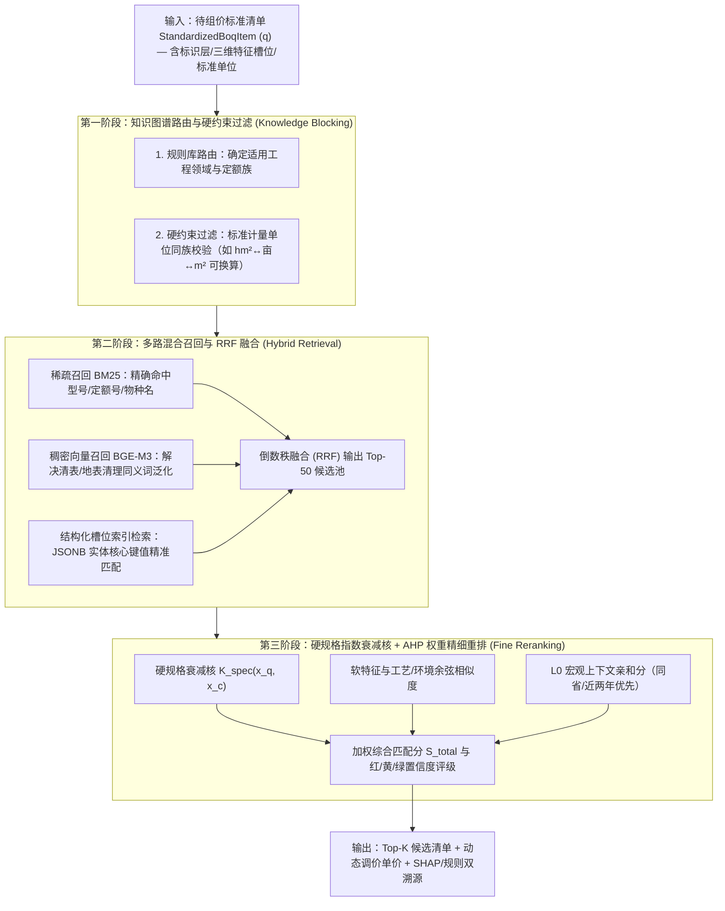

# 融合领域知识的智能价格匹配、动态调价与合规校验技术白皮书

> **关联文档**：[统一领域词汇表 (GLOSSARY.md)](../GLOSSARY.md) ｜ [架构契约与接缝规范](01-ARCHITECTURE-AND-CONTRACTS.md) ｜ [ADR-0003 硬规格衰减核混合匹配](adr/0003-hard-spec-decay-hybrid-matching-over-pure-embeddings.md)
> **科研对应交付物**：《智能匹配模型技术白皮书》、发明专利《一种融合领域知识的工程量清单智能匹配方法》技术交底底稿

---

## 一、 “知识推理优先、数据预测补充、融合决策优化”三段式混合匹配架构

针对工程量清单兼具“专业术语同义异形”和“硬规格数值高度敏感”的双重特性，本系统构建了三段式混合匹配流水线（`PriceMatchingModule`）：

### 1.1 第一阶段：知识图谱路由与硬约束过滤
在进入向量检索之前，首先通过规则知识图谱过滤明显不兼容的候选集合：
* **领域与类别路由**：若待匹配项属于 `07_installation`（如电力电缆），直接屏蔽 `01_water_ecology` 的苗木栽植条目。
* **计量单位同族约束**：候选清单的标准单位必须与待匹配清单单位相同，或处于同一物理量纲换算族内（如 `hm²` 与 `亩`、`m²` 可通过系数换算，但绝不允许将 `套`（电缆终端头）匹配给 `m`（电力电缆敷设））。

### 1.2 第二阶段：多路混合召回与倒数秩融合（RRF）
为兼顾精确工程型号词与自然语言同义词，同时并发执行三路召回，并通过**倒数秩融合（Reciprocal Rank Fusion, RRF）**合并生成候选集 $C_{\text{pool}}$（默认 Top-50）：

$$S_{\text{RRF}}(d) = \sum_{r \in \{\text{BM25}, \text{Dense}, \text{Slot}\}} \frac{1}{k + \text{rank}_r(d)}, \quad k = 60$$

其中：
* **BM25 稀疏检索**：对分词后的型号编码（如 `ZR-YJV`、`DJYVP`、`10224`、`黑沙蒿`）赋予极高逆文档频率（IDF）权重；
* **稠密向量检索**：对拼接 `{分部路径 + 标准主名称 + 规范特征串}` 编码得到语义向量，召回同义表达（如将 `清表，推土机推土` 召回至 `地表清理`）；
* **结构化槽位检索**：直接在数据库 JSONB 索引中按 `standard_name` 与核心实体键值取交集补全召回。

### 1.3 第三阶段：硬规格指数衰减核与 AHP 权重精细重排（核心创新模型）

对于候选池中的每一条历史清单 $c \in C_{\text{pool}}$，计算其与查询清单 $q$ 的综合匹配得分 $S_{\text{total}}(q, c) \in [0, 1]$：

$$S_{\text{total}}(q, c) = \lambda_{\text{feat}} \cdot \sum_{k \in \mathcal{S}_q \cup \mathcal{S}_c} w_k^{\text{AHP}} \cdot \Phi_k(q, c) + \lambda_{\text{sem}} \cdot S_{\text{dense}}(q, c) + \lambda_{\text{ctx}} \cdot S_{\text{ctx}}(q, c)$$

其中权重系数满足 $\lambda_{\text{feat}} + \lambda_{\text{sem}} + \lambda_{\text{ctx}} = 1$（默认工业基线：$\lambda_{\text{feat}} = 0.65,\ \lambda_{\text{sem}} = 0.20,\ \lambda_{\text{ctx}} = 0.15$），$w_k^{\text{AHP}}$ 为由领域特征本体 YAML 提供的槽位 AHP 权重（$\sum_k w_k^{\text{AHP}} = 1$）。

各核心子项定义如下：

1. **槽位匹配核函数 $\Phi_k(q, c)$**：
   * **数值型硬约束槽位**（如电缆等效截面 `cross_section_eq_mm2`、土方运距 `haul_distance_m`、苗木地径 `stem_diameter_cm`）：采用**硬规格指数衰减核（Hard-Spec Decay Kernel）**：
     $$\Phi_k^{\text{num}}(x_q, x_c) = \exp\left(-\alpha_k \cdot \frac{|x_q - x_c|}{\max(x_q, x_c, \epsilon)}\right)$$
     当存在不可容忍的跨档硬规格冲突（如主芯截面偏差 $> 30\%$ 或运距相差 $> 2$ 倍）时，令惩罚系数 $\alpha_k \in [3.5, 6.0]$，同时标记 `has_hard_spec_conflict = True`。
     * **实证校验**：针对 `data/二级泵站电缆综合单价.pdf` 中第 9 项 `3*150+1*95`（等效 $545\text{ mm}^2$，单价 1194.67 元/m）与第 10 项 `3×25+1×16`（等效 $91\text{ mm}^2$，单价 133.15 元/m），若 $\alpha = 4.5$，则：
       $$\Phi_{\text{section}} = \exp\left(-4.5 \times \frac{545 - 91}{545}\right) = \exp(-3.748) \approx 0.0235$$
       结合槽位权重 $w = 0.42$，彻底消除纯余弦相似度（$>0.96$）引发的 9 倍价格错配风险！
   * **枚举/类别型硬约束槽位**（如植物品种 `species`、电缆型号 `cable_model`、安装场所 `户内/户外`）：完全一致取 `1.0`，同族近义词（如 `ZR-YJV` 与 `YJV`）由领域同义矩阵赋予折减系数 `0.70`，跨大类互斥（如 `电力电缆` vs `控制电缆`）取 `0.0` 并触发冲突标识。
   * **缺失惩罚**：若查询项包含硬约束槽位 $k$ 而历史候选缺失该槽位，$\Phi_k = 0.30$（降权警告但不直接丢弃）。

2. **项目宏观上下文亲和分 $S_{\text{ctx}}(q, c)$**：
   $$S_{\text{ctx}}(q, c) = 0.50 \cdot \mathbb{I}(\text{prov}_q = \text{prov}_c) + 0.25 \cdot \mathbb{I}(\text{stage}_q = \text{stage}_c) + 0.25 \cdot \exp\left(-0.15 \cdot |\text{year}_q - \text{year}_c|\right)$$
   保证同省份、同造价阶段、近年份的历史样本优先胜出。

3. **三级置信度分级策略**：
   * 🟢 **High（高置信度）**：$S_{\text{total}} \ge 0.85$ 且 `has_hard_spec_conflict == False`；
   * 🟡 **Medium（中置信度）**：$0.65 \le S_{\text{total}} < 0.85$ 且 `has_hard_spec_conflict == False`；
   * 🔴 **Low（低置信度预警）**：$S_{\text{total}} < 0.65$ 或 `has_hard_spec_conflict == True`（前端强制标红并提示人工核定或插值）。

---

## 二、 三大跨区域、跨期与近邻规格动态调价算子

匹配到最相似的历史清单后，`PriceAdjustmentModule` 根据候选清单的数据完整度自动调度以下三类可插拔调价算子（`PriceAdjusterPort`）：

### 2.1 算子 1：同域直接复用算子（`DirectReuseAdjuster`）
* **触发条件**：候选清单与目标项目同省份、时间间隔 $\le 12$ 个月、同造价阶段且无硬规格差异。
* **计算逻辑**：直接沿用标准化换算后的历史综合单价（若计量单位不同，如目标用 `亩` 而历史用 `hm²`，自动乘以单位换算系数 $1/15$）。

### 2.2 算子 2：基于 L2 定额工料机的主材价差动态重算算子（`QuotaMaterialDiffAdjuster`）
* **触发条件**：候选清单具备 L2 `UnitPriceBreakdown`（例如高明区土地整治项目包含完整的定额 `10224` 工日、台班与主材消耗量），且目标新项目提供了最新的本地人工单价或主要材料信息价。
* **重算公式**（严格遵循真实造价取费结构）：
  1. 替换并重算定额直接工程费与主材价差：
     $$\Delta P_{\text{mat}} = \sum_{m \in \mathcal{M}} Q_m \cdot \left(P_m^{\text{target}} - P_m^{\text{base}}\right)$$
  2. 联动重算措施费 $F_{\text{meas}}$、间接费 $F_{\text{ind}}$、利润 $F_{\text{prof}}$ 与增值税 $F_{\text{tax}}$：
     $$P_{\text{adj}} = \frac{1}{U_{\text{quota}}} \Big[ \left(F_{\text{direct}}^{\text{new}} \cdot (1 + r_{\text{ind}}) \cdot (1 + r_{\text{prof}}) + \Delta P_{\text{mat}}^{\text{new}}\right) \cdot (1 + r_{\text{tax}}) \Big]$$
  * **真实案例推演（高明区 `1.1.1.2.2 土（石）方运输，运距5km`）**：
    原定额 `10224` 单位为 `100m³`，含 `柴油 127.56 kg`，原佛山除税预算价 `7.00 元/kg`（基价 `4.50 元/kg`，价差 `318.89 元`），总计 `2162.90 元/100m³`（即 `21.63 元/m³`）。当某内蒙古新项目引用该清单、且当地柴油最新价为 `7.40 元/kg`（如西柳沟项目）时，算子自动将柴油价差重算为 $127.56 \times (7.40 - 4.50) = 369.92\text{ 元}$，联动税金重算后得出新综合单价 `22.18 元/m³`，并向造价员展示完整调差明细。

### 2.3 算子 3：地区时间指数修正与近邻规格插值算子（`RegionalTimeIndexAdjuster` / `SpecInterpolationAdjuster`）
* **跨期指数平滑修正（ES-CBR）**：对于仅含 L1 综合单价的条目（如西柳沟生态灌木栽植），依据来源地与目标地造价指数比值 $I_{\text{target}} / I_{\text{hist}}$ 进行系数修正。
* **近邻规格插值**：当待估项为 `ZR-YJV-0.6/1KV-3×95+1×50` 而库中缺乏精确值但存在同型号 `3×70+1×35`（334.20 元/m）和 `3×150+1×95`（1194.67 元/m）时，按等效截面积构造局部单价拟合曲线给出插值参考区间。

---

## 三、 多层次可解释性生成机制（SHAP + 规则与案例双溯源）

为杜绝 AI 模型的“黑盒推荐”，`ExplainerPort` 为每一条推荐输出三层可解释证据：
1. **特征槽位逐项对比表（Slot-Level Diff）**：清晰列示“查询项值 vs 历史项值”、“单项相似度”、“是否硬冲突”（如 `运距：目标 3km vs 历史 5km | 相似度 0.67 | 建议关注`）。
2. **SHAP / AHP 特征贡献归因值**：计算每个特征槽位 $k$ 相对于基线期望得分的边际贡献度：
   $$\phi_k(q, c) = w_k^{\text{AHP}} \cdot \left(\Phi_k(q, c) - \mathbb{E}[\Phi_k]\right)$$
   以正负向柱状图呈现（绿色正向拉升匹配度、红色负向扣分原因）。
3. **双溯源卡片（Provenance Card）**：关联展示历史来源项目名称、所属省份、价格基准年月、所套用的定额编号（如 `水总〔2024〕323号` 或 `10224`）及 L2 人/材/机费用结构占比。

---

## 四、 清单合规与合理性审查规则引擎（`BQ001` ~ `BQ012`）

借鉴开源项目 `KanadeK/boq-check` 的本地可扩展 Linter 思想，系统内置 12 条独立可插拔的合规审查规则（`AuditRulePort`），在批量组价与导出前自动扫描全表并过滤章节小计行：

| 规则编号 | 规则名称 | 默认级别 | 检查逻辑与工程意义 |
| :--- | :--- | :---: | :--- |
| **`BQ001`** | 清单名称缺失检查 | `Error` | 明细行项目名称为空或仅为纯符号占位符。 |
| **`BQ002`** | 计量单位缺失或非标检查 | `Error` | 计量单位为空，或使用“批”“宗”替代可计量物理单位（如面积、长度）。 |
| **`BQ003`** | 项目编码规范性检查 | `Warning` | 处于国标清单阶段但缺失 12 位项目编码，或编码长度异常。 |
| **`BQ004`** | 硬约束特征槽位缺失检查 | `Warning` | 依据所属专业 YAML 本体，检测核心规格（如电缆截面积、土方运距、苗木地径）是否漏填。 |
| **`BQ005`** | 数值格式与非正数检查 | `Error` | 数量、单价或合价存在文本混入、Excel 未解析公式错误（`#REF!`）或异常负值。 |
| **`BQ006`** | 算术闭合一致性检查 | `Error` | 校验 $|\text{数量} \times \text{综合单价} - \text{合价}|$（自动识别元/万元量纲），误差超过 1% 报错。 |
| **`BQ007`** | 同表同名同特征单位冲突 | `Error` | 同一项目中项目名称与特征完全一致的条目使用了不同计量单位（如 `m²` 与 `hm²` 混用）。 |
| **`BQ008`** | 同表同名同特征单价不一致 | `Warning` | 同一项目中相同名称与特征的清单项综合单价离散不一致（提示排查是否存在人为录入错行）。 |
| **`BQ009`** | 历史同类单价大幅偏离预警 | `Warning` | 当前拟定单价偏离历史库同专业同规格均值超过 $\pm 25\%$ 或超出四分位距（$1.5 \times \text{IQR}$）。 |
| **`BQ010`** | 置信度红灯未确认阻断 | `Error` | 批量自动组价后仍存在未经过人工确认的 🔴 低置信度条目时，阻止直接导出终稿。 |
| **`BQ011`** | 文本冗余与断行污染检查 | `Notice` | 检测单元格内多余换行、不可见控制字符或 `*`/`×` 规格符号混用（自动提示一键清洗）。 |
| **`BQ012`** | 关联工作内容重复计价风险 | `Notice` | 联动规则知识图谱检查工作内容包含冲突（例如电力电缆单价已含“电缆头制作安装”，而同表又单列全套终端头计价项时给出核查提醒）。 |

---

## 五、 科研对比与消融实验评测方案

为直接产出《模型性能评估报告》、1 项发明专利及 2 篇学术论文，系统内置标准评测脚本 `evaluate_matchers.py`，利用 `RerankerPort` 插件机制在同一真实历史数据集（采用 5-Fold 按项目隔离交叉验证，防止同项目泄露）上运行以下基线对比与消融实验：

| 对比模型 / 消融变体 | 插件配置名 | 目的与验证假设 |
| :--- | :--- | :--- |
| **Baseline 1：纯稀疏词检索** | `bm25_only` | 验证缺乏语义泛化时对同义工程术语的漏召回问题。 |
| **Baseline 2：LSTM + 余弦相似度** | `lstm_cosine` | 验证立项书初版技术路线在面对复合数字规格（如电缆截面、运距）时的局限性。 |
| **Baseline 3：纯稠密向量检索** | `bge_dense_only` | 验证纯大模型向量在硬规格敏感任务上的精度瓶颈。 |
| **Baseline 4：知识图谱嵌入重排** | `transe_rgcn_reranker` | 验证仅依赖图谱结构关系在长尾非标描述上的表现。 |
| **Ablation 1：无硬规格核混合模型** | `hybrid_without_decay` | 消融实验：剥离硬规格指数衰减核，量化衰减核对消除高价差错配的贡献度。 |
| **Ours：三段式知识+混合核模型** | `production_hybrid` | 验证**多路混合召回 + 硬规格指数衰减核 + AHP 权重 + L2 动态调价**综合方案的最优性。 |

### 统一量化评测指标
* **排序匹配精度**：`Top-1 Accuracy`、`Top-3 Hit Rate`、`MRR`（Mean Reciprocal Rank）、`NDCG@5`。
* **单价预测精度**：平均绝对百分比误差（`MAPE`）、均方根误差（`RMSE`）以及**硬规格严重错配率（Spec Conflict Rate，目标 $= 0\%$）**。
